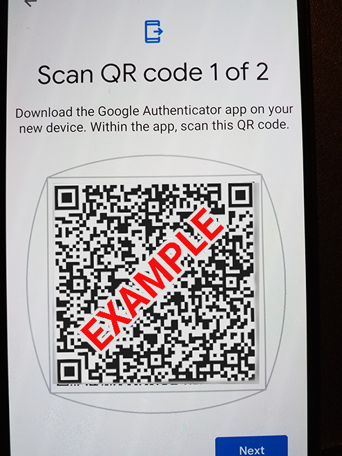
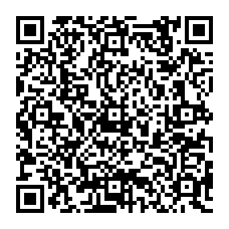

# GAuthExport

Move your accounts from Google Authenticator to any other 2FA app, without having to disable and re-enable 2FA on each account.

Google Authenticator's **Transfer accounts → Export accounts** feature produces QR codes that only Google Authenticator can read. GAuthExport decodes those QR codes, extracts each account, and generates a standard QR code per account that any 2FA app can scan.

## Usage

```bash
python gauthexport.py (--image PATH [PATH ...] | --text TEXT [TEXT ...]) [--output_directory PATH]
```

You can pass in either images of the export QR codes or the raw text those QR codes contain.

| Argument | Description | Example |
|---|---|---|
| `--image PATH [PATH ...]` | One or more images containing a Google Authenticator export QR code. | `--image input1.png input2.png` |
| `--text TEXT [TEXT ...]` | One or more raw text contents of a Google Authenticator export QR code. | `--text "otpauth-migration://offline?data=..."` |
| `--output_directory PATH` | *Optional.* Folder to save the generated QR codes in. Defaults to the current directory. | `--output_directory .\output` |

## Example

1. In Google Authenticator, export your accounts to get a QR code. Save a photo or screenshot of it, here called `input.png`:

   

2. Run GAuthExport on the image:

   ```bash
   python gauthexport.py --image input.png --output_directory .\output
   ```

3. GAuthExport saves one QR code per account to the output folder, for example:

   ```text
   .\output\GAuthExport_username@mail.com_DJVUENBVOAWEIVKAWE_serviceprovider.png
   ```

   

   This QR code contains:

   ```text
   otpauth://totp/username@mail.com?secret=DJVUENBVOAWEIVKAWE&issuer=serviceprovider
   ```

4. Scan each generated QR code with your new 2FA app.

> [!WARNING]
> The export QR codes and the generated QR codes contain your 2FA secrets. So do the generated file names. Anyone who has them can generate your 2FA codes. Once you've imported your accounts, delete the input images and the output folder, and don't share them or commit them anywhere.
